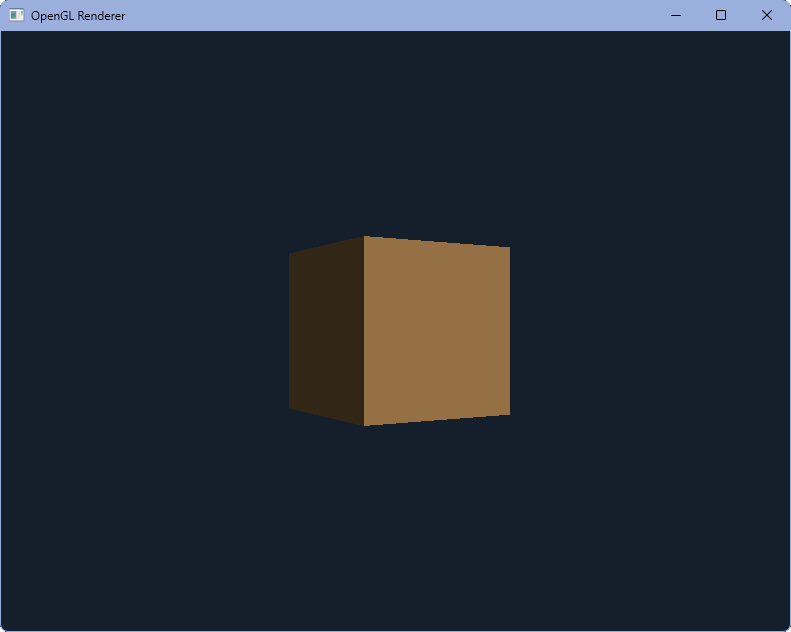

# OpenGL Renderer

A small C++20 renderer for OpenGL 3.3. It opens a window, loads the included cube from an OBJ mesh, rotates it with fixed diffuse lighting, and reads window settings from JSON. The project is in early development and is also a learning project.



---

**Status:** Early development (`v0.2.4`).

> [!WARNING]
> The code changes frequently, and APIs and features may not be stable yet.

---

## Contents

- [Building](#building)
  - [Windows (MSYS2, MinGW-w64)](#windows-msys2-mingw-w64)
  - [Linux](#linux)
  - [Presets](#presets)
  - [VS Code](#vs-code)
  - [Making a release](#making-a-release)
- [Testing](#testing)
- [GitHub automation](#github-automation)
- [GitHub wiki](#github-wiki)
- [Running](#running)
- [Project layout](#project-layout)
- [License](#license)
- [Contributing](#contributing)
- [Third-party software](#third-party-software)

## Building

You need a C++20 compiler with `<format>` support, CMake 3.24 or newer, Ninja, and Git. On GCC that means version 13 or newer. Ubuntu 22.04 and Debian 12 ship older compilers by default, so use Ubuntu 24.04 or newer, or install a newer GCC.

Running the renderer also requires a desktop session and graphics driver with OpenGL 3.3 support. The settings tests do not need a display or GPU.

CMake manages GLFW, nlohmann/json, and tinyobjloader. On Linux, it uses system-installed GLFW and nlohmann/json when available; otherwise, it downloads and builds them.

> [!NOTE]
> An internet connection may be required when configuring a fresh build.

**Actively tested platforms:**
- [Windows (MSYS2 / MinGW-w64)](#windows-msys2-mingw-w64)
- [Linux](#linux)

macOS builds in CI and has startup code for it (executable path lookup and a forward-compatible OpenGL context), but nobody has run the renderer on a Mac yet. Treat it as untested.

You can follow the platform-specific instructions *below* to set up and build the project:

### Windows (MSYS2, MinGW-w64)

1. Install [MSYS2](https://www.msys2.org/).
2. Open an MSYS2 UCRT64 terminal and install the required tools:

   ```bash
   pacman -S mingw-w64-ucrt-x86_64-gcc mingw-w64-ucrt-x86_64-cmake mingw-w64-ucrt-x86_64-ninja git
   ```

3. Add `C:\msys64\ucrt64\bin` to your `PATH` so `g++` is available in PowerShell and VS Code.
4. From the repository root, configure and build the Debug preset:

   ```bash
   cmake --preset debug
   cmake --build --preset debug
   ```

5. Run the executable:

   ```powershell
   .\build\debug\OpenGLRenderer.exe
   ```

### Linux

**Arch Linux and derivatives** *(CachyOS, Manjaro, etc.)*:

```bash
sudo pacman -S base-devel cmake ninja git glfw nlohmann-json
```

**Debian and Ubuntu:**

```bash
sudo apt install build-essential cmake ninja-build git pkg-config \
    libwayland-dev libxkbcommon-dev wayland-protocols \
    libx11-dev libxrandr-dev libxinerama-dev libxcursor-dev libxi-dev
```

Configure and build the Debug preset:

```bash
cmake --preset debug
cmake --build --preset debug
```

Run the executable from the repository root:

```bash
./build/debug/OpenGLRenderer
```

> [!NOTE]
> On Linux, CMake uses system-installed GLFW and nlohmann/json when available.
> If they are not installed, CMake downloads and builds them, which requires the X11/Wayland development packages listed above.

### Presets

| Preset | Build configuration | Output directory |
| --- | --- | --- |
| `debug` | Debug build, typically with compiler optimizations disabled | `build/debug/` |
| `release` | Optimized Release build | `build/release/` |

Use either preset name with:

```bash
cmake --preset <name>
cmake --build --preset <name>
```

Replace `<name>` with `debug` or `release`.

### VS Code

Install the recommended C/C++ and CMake Tools extensions when VS Code prompts you to do so.

Opening the repository configures the Debug preset and provides IntelliSense with the generated compile commands.

Use `Ctrl+Shift+B` to configure and build the Debug target, then run the **OpenGL Renderer: run Debug** task from **Terminal: Run Task**.

### Making a release

Configure and build the release packaging target:

```bash
cmake --preset release
cmake --build --preset release --target package_release
```

This creates a ready-to-run program folder and a ZIP archive under the generated `release/` directory. The package directory uses the project version and build date. The package contains the executable, `assets/`, `LICENSE`, `README.md`, and `THIRD_PARTY_LICENSES.txt`.

The version number comes from `project(... VERSION ...)` in [`CMakeLists.txt`](CMakeLists.txt). Change it there to update the project version used for packaging.

## Testing

Build the project with one of the presets above, then run CTest from the corresponding build directory:

```bash
ctest --test-dir build/debug --output-on-failure
ctest --test-dir build/release --output-on-failure
```

The current tests cover settings and JSON validation. They use temporary files and do not initialize GLFW or OpenGL.

## GitHub automation

The [`Build`](.github/workflows/build.yml) workflow configures, builds, and tests Debug and Release on Ubuntu, macOS, and Windows for pull requests targeting `main`, pushes to `main`, and manual runs. Release jobs also build and verify the package. On `main` pushes and manual runs, the workflow uploads the Release executable and assets plus a separate package archive for each operating system. Pull request builds do not upload artifacts. Artifacts are retained for seven days.

## GitHub wiki

The Markdown files in [`docs/wiki/`](docs/wiki/) are the source for the GitHub wiki. Do not edit published wiki pages directly because the [`Publish wiki`](.github/workflows/publish-wiki.yml) workflow replaces the wiki contents with this directory.

The [architecture guide](docs/wiki/Architecture.md) describes how startup, settings, assets, OpenGL rendering, and resource lifetime fit together. The [project structure page](docs/wiki/Project-structure.md) maps those responsibilities to files.

Before the first publish:

1. Confirm the repository wiki is enabled in GitHub's repository settings.
2. Create a personal access token restricted to this repository with permission to write repository contents. A classic token needs the `repo` scope.
3. Save it as the repository Actions secret `WIKI_TOKEN`.
4. Run **Publish wiki** manually from the Actions tab.

After that, pushes to `main` that change `docs/wiki/` publish the updated wiki automatically.

## Running

The program reads shipped, read-only content from the `assets/` directory next to the executable, so you can launch it from any working directory. Meshes, textures, shaders, and other large game content belong there rather than inside the executable.

Every build copies the repository's [`assets/`](assets/) directory beside the executable.

To test shader or mesh changes without recompiling C++, edit the copied assets next to the executable. Changes made in the repository's source `assets/` directory are copied on the next build.

On first launch, the default settings template at [`assets/config/settings.json`](assets/config/settings.json) is copied to a writable per-user file. The renderer then reads settings from that user file and never overwrites it:

- Windows: `%LOCALAPPDATA%\OpenGLRenderer\settings.json`
- Linux: `$XDG_DATA_HOME/openglrenderer/settings.json`, or `~/.local/share/openglrenderer/settings.json` when `XDG_DATA_HOME` is unset

Window size, title, wireframe mode, and VSync are configured there. Delete the user settings file to recreate it from the shipped default template.

Missing keys keep their built-in defaults and produce a `WARN` log entry. A missing `window` section keeps all defaults without warnings; a present `window` value must be an object. Width and height must be JSON integers from 1 through 16384. Wrong value types, malformed JSON, and out-of-range dimensions produce a configuration error and exit code 2. If the settings file cannot be opened, startup reports a configuration error rather than silently replacing it with defaults. On Windows, Debug writes logs to its console; Release has no console window and writes startup output to `%LOCALAPPDATA%\OpenGLRenderer\openglrenderer.log`.

> [!TIP]
> Press `Esc` to quit.

## Project layout

| Path | Purpose |
| --- | --- |
| [`src/`](src/) | C++ implementation files and the application entry point |
| [`src/headers/`](src/headers/) | Project-owned C++ declarations included by the renderer sources |
| [`assets/`](assets/) | Shipped, read-only shaders, meshes, textures, and default configuration, copied beside the executable during the build |
| [`third_party/`](third_party/) | GLAD, the OpenGL function loader; generated code kept in the repository |
| [`cmake/`](cmake/) | Helper scripts used by CMake |
| `build/` | Build output, ignored by Git |
| `release/` | Packaged releases, ignored by Git |

## License

This project uses the [PolyForm Noncommercial License 1.0.0](LICENSE).

In plain terms:

- You can read the code, learn from it, and use it for noncommercial purposes.
- You can fork the project and make changes for noncommercial purposes.
- You **cannot use the project commercially** under this license without separate permission.

If you redistribute the project, you must comply with the license conditions, including retaining the license text and the `Required Notice:` line from [`LICENSE`](LICENSE).

Please link to this repository instead of rehosting builds, so users can find the latest version.

The [`LICENSE`](LICENSE) file contains the full license terms. This summary is provided for convenience and does not replace or modify them.

## Contributing

Issues and pull requests are welcome.

By submitting a contribution, you confirm that you wrote it or have the right to submit it.
You agree to license the contribution under the same terms as the project and grant the project owner the right to use it in commercial releases of this project or of games built from it.

**If you are not comfortable with these terms, please open an issue to discuss them before submitting a contribution.**

## Third-party software

| Library | Purpose | License |
| --- | --- | --- |
| [GLFW](https://www.glfw.org/) 3.5.1 | Window creation, input, and OpenGL context management | zlib |
| [glad](https://github.com/Dav1dde/glad) 0.1.36 | OpenGL function loader | MIT / public domain |
| [nlohmann/json](https://github.com/nlohmann/json) 3.12.0 | JSON parsing | MIT |
| [tinyobjloader](https://github.com/tinyobjloader/tinyobjloader) 2.0.0rc13 | Wavefront OBJ loading | MIT |

The full license texts are in [`THIRD_PARTY_LICENSES.txt`](THIRD_PARTY_LICENSES.txt), which is also included in release packages. Update it when you change a pinned version.

The cube demo mesh was created by Morgan McGuire and released into the public domain.
Its source and attribution are documented in [`assets/meshes/cube/cube.obj`](assets/meshes/cube/cube.obj).
